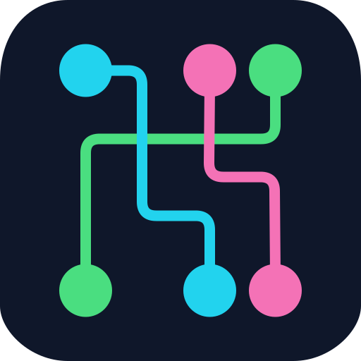

<p align="center">
  
</p>

<h1 align="center">EasySchematic</h1>

<p align="center">A drag-and-drop AV signal flow diagram tool for designing and documenting AV system hook-ups.<br>Built for broadcast, live production, and AV integration workflows.</p>

<p align="center"><b><a href="https://easyschematic.live">Try it live →</a></b> · <b><a href="https://docs.easyschematic.live">Documentation →</a></b> · <b><a href="https://docs.easyschematic.live/dev/">Developer Reference →</a></b> · <b><a href="https://devices.easyschematic.live">Device Database →</a></b> · <b><a href="https://discord.gg/dxXn3Jk2a6">Discord →</a></b> · <b><a href="https://ko-fi.com/duremovich">Support the project →</a></b></p>

<h3 align="center">Supported by</h3>

<p align="center">
  <a href="https://cumoratek.com/">
    
  </a>
</p>

<p align="center"><sub><b>Individual supporters</b><br/>Sean Curtis · HI-T3C · Brandon Meyers · Srdjan T</sub></p>

---

Draw your signal flow, and the paperwork comes with it. Devices, racks, patch
bays, and print sheets all live in one file, so a cable schedule, pack list, and
rack elevation are views of the same drawing instead of three spreadsheets that
drift apart.

Free, browser-based, no account required. Installs as a desktop app and keeps
working offline.

> This README is the highlights reel. The full feature-by-feature reference
> lives at **[docs.easyschematic.live](https://docs.easyschematic.live)**.

## Highlights

### Canvas & connections

- **Click-to-connect or drag-to-connect** — a preview line follows the cursor and
  snaps to nearby valid ports: green for a valid target, yellow when an adapter
  will bridge the gap, and red with the reason when it can't connect. Click a
  device body to auto-connect the first compatible port.
- **Smart routing** — A\* pathfinding routes cables around devices with parallel
  nesting and line-jump arcs. Add waypoints by hand where the algorithm gets it
  wrong, or switch routing off entirely for lag-free editing on big drawings.
- **[74 signal types](#signal-types)**, each color-coded and individually
  restylable, with per-signal line styles, per-connection line widths, and a
  customizable color palette saved in the file.
- **Adapters insert themselves** between incompatible ports, with gender
  awareness, direct-attach support, and barrels.
- **Bundles** — select a group of connections and run them down one shared trunk
  like a snake, mixed signal types included. Each member stays its own cable in
  the schedule and pack list.
- **Rooms** — resizable containers for control rooms, racks, trucks, and stages,
  nestable and lockable, with room-to-room distances feeding estimated cable
  lengths.

### Devices

- **3,800+ device templates** from the [community device
  library](https://devices.easyschematic.live), fetched live, with a bundled
  core set as an offline fallback so the app keeps working without a connection.
- **Build anything that isn't there** — a guided builder for matrix routers,
  breakout panels, patch bays, and anything else with structured I/O; save your
  own as reusable templates and share them back to the community.
- **Expansion slots** — chassis with swappable card bays, including cards with
  their own sub-slots for SFP/QSFP transceivers.
- **Swap Device** — replace a device with a different model and a mapping dialog
  proposes where every existing connection lands, carries installed cards across,
  and auto-installs cards where the new chassis needs them. One undo step.
- **Real-world data on every device** — dimensions, weight, power draw, hostname
  and IP, unit cost, venue-provided flag — all of which feed the reports.

### Rack Builder

A rack elevation surface alongside the signal flow, sharing devices by
reference — place a device on a rack and it stays the same device on the
schematic, connections and all.

- Floor, wall, desktop, and open 2-post/4-post rack presets, or a custom rack
- Drag devices from the unracked sidebar with snap-to-U placement, collision
  detection, half-rack pairing, and auto-shelving for non-rack-mount gear
- Front, rear, and side views — face plates with connectors, occupancy ghosts,
  and depth conflicts
- **Face-plate editor** for connector positions, with 78 connector types drawn
  at mm-accurate dimensions
- Accessories: shelves, vent panels, blanks, drawers, cable managers, fans

### Patch Bay

Route connections through patch panels without drawing the panels on the
schematic. Virtual panels appear in the reports and racks, click-to-patch handles
multi-panel hops, per-segment cable IDs get letter suffixes (`E001-A/-B/-C`), and
designation strips print at 100% physical scale for the panel's label holder.

### Print Sheets

Paper pages for composing rack viewports into a printable drawing — Letter
through A0 and custom sizes, drag-and-resize viewports with alignment guides,
title blocks and stats lines, and a **vector PDF export** that carries mounting
holes, occupancy stripes, and shelf occupants at full fidelity.

### Paperwork

- **Pack list** — bill of materials for devices and cables, cross-referenced
  against your **Owned Gear** inventory so it tells you what to pull from the shop
  and what to rent
- **Cable schedule** — every connection with cable IDs, connectors, gender,
  lengths (estimated from room distances), and bundle grouping
- **Patch panel schedule**, **network report** (IP, VLAN, DHCP, PoE), and **power
  report** with load analysis
- **WYSIWYG report editor** — column visibility, grouping, sorting, and a
  header/footer grid editor for title blocks; exports to PDF and CSV

### Files & exports

- **Print** — Standard, ISO A0–A4, ANSI, Architectural, or custom paper, with
  orientation, scale, and an optional, configurable title block
- **DXF** for AutoCAD and Vectorworks, with organized layers; plus **PDF**,
  **PNG** (4x), and **SVG**
- **JSON** import/export with schema versioning and migrations
- **CSV cable schedule import** — turn an existing spreadsheet into a schematic
- **Optional free account** for cloud saves (up to 10 schematics), share links,
  and access from any browser; everything else stays local

### AI assistant (Beta)

EasySchematic speaks [MCP](https://docs.easyschematic.live/ai-assistant), so an
assistant like Claude can read and edit your schematic live — searching the
library, placing devices, making validated connections, and writing notes, with
the results appearing on your canvas as it works. The bridge runs on
`127.0.0.1` only, is off by default, and requires a one-time pairing token.

### Community device database

[devices.easyschematic.live](https://devices.easyschematic.live) is a browsable,
searchable, installable-offline catalog. Submit new devices or edits by
magic-link email — or right-click a device on your canvas and choose **Submit to
Community** to seed a submission from what you've already filled in. Approved
submissions credit the contributor.

#### Public API

If you're building AV tooling and need a structured database of professional
audiovisual equipment with port definitions, signal types, and connector types,
help yourself:

- `GET https://api.easyschematic.live/templates` — all device templates
- `GET https://api.easyschematic.live/templates/:id` — single template with contributor attribution

Responses are JSON, cached for 5 minutes, no auth required. See the [full API
reference](https://docs.easyschematic.live/api) for additional endpoints.

## Signal Types

SDI · HDMI · NDI · Dante · AVB · Analog Audio · Speaker-Level · AES · AES67 ·
AES50 · MADI · DMX · Art-Net · sACN · USB · Ethernet · Fiber · DisplayPort ·
HDBaseT · SRT · ST 2110 · Genlock · Word Clock · Timecode · Tally · GPIO ·
Contact Closure · RS-422 · RS-485 · Serial · Thunderbolt · MIDI · S/PDIF · ADAT ·
Ultranet · StageConnect · SoundGrid · BLU link · Cresnet · nLight · RF · Power
(L1/L2/L3/N/G) · Custom — [74 in
total](https://docs.easyschematic.live/device-template-schema), all color-coded
and customizable.

## Getting Started

```bash
npm install
npm run dev
```

Open [http://localhost:5173](http://localhost:5173) in your browser.

## Build

```bash
npm run build
```

Output goes to `dist/` — deploy as a static site anywhere.

## Self-Hosting with Docker

```bash
docker compose up -d
```

Open [http://localhost:8080](http://localhost:8080). This builds the frontend
from source and serves it with nginx. Cloud features (save to cloud, device
submissions, sharing) still talk to the hosted API at `api.easyschematic.live` —
no account or API key required for read access.

| Command | Description |
|---------|-------------|
| `make build` | Build the Docker image |
| `make up` | Start the container (port 8080) |
| `make down` | Stop the container |
| `make restart` | Restart the container |
| `make logs` | Tail container logs |
| `make build-clean` | Rebuild with no cache |

The `makefile` is just a convenience wrapper around `docker compose`. To change
the port, edit the first number in the port mapping in `compose.yml`. See the
[Self-Hosting docs](https://docs.easyschematic.live/self-hosting) for reverse
proxy setup and more.

## Install as a Desktop App

EasySchematic installs as a standalone app that works offline — no download page,
no account, no app store. Visit [easyschematic.live](https://easyschematic.live)
and install from your browser:

- **Chrome / Edge** — the install icon in the address bar, or Menu → "Install EasySchematic"
- **Safari (macOS Sonoma+)** — File → Add to Dock
- **Safari (iOS / iPadOS)** — Share → Add to Home Screen
- **Android** — the browser prompts automatically, or Menu → "Install app"

The installed app opens in its own window, works fully offline, and updates when
you're back online. EasySchematic is built for a desktop-sized screen with a
keyboard and mouse.

## Design Principles

1. **AV signal flow, nothing else.** This is a tool for designing audiovisual
   systems — not a general diagramming app. Every feature decision starts from
   "does this serve AV workflows?"

2. **Your workflow, your way.** Signal colors, display names, device templates,
   port layouts — customization is a first-class feature. Different shops work
   differently, and the tool should adapt to you, not the other way around.

3. **Simple to start, deep to master.** A student can drag devices and draw
   cables in five minutes. The depth is there when you need it, but it's never in
   your face on day one.

4. **Automate the tedious, not the creative.** Smart routing, auto-numbering, and
   sensible defaults handle the grunt work. When the algorithm gets it wrong,
   manual overrides put you back in control.

5. **Community-built device library.** The shared device database grows because
   users contribute to it. Submit a template, everyone benefits.

## Tech Stack

- [React 19](https://react.dev) + [TypeScript](https://www.typescriptlang.org/)
- [@xyflow/react v12](https://reactflow.dev) — canvas
- [Zustand v5](https://zustand.docs.pmnd.rs/) — state management
- [Tailwind CSS v4](https://tailwindcss.com) — styling
- [Vite 8](https://vite.dev) — build tool
- [Cloudflare Workers + D1](https://developers.cloudflare.com/) — API and device database

## Keyboard Shortcuts

| Shortcut | Action |
|----------|--------|
| Click port | Start click-to-connect |
| `Escape` | Cancel connection / deselect |
| `Space` + drag | Pan canvas |
| `Delete` / `Backspace` | Delete selected |
| `Ctrl+S` / `Ctrl+Shift+S` | Save / Save As |
| `Ctrl+O` | Open schematic |
| `Ctrl+C` / `Ctrl+V` | Copy / paste |
| `Ctrl+A` | Select all |
| `Ctrl+Z` / `Ctrl+Shift+Z` | Undo / redo |
| `F9` | Toggle Print View |
| `Shift` + click | Toggle item in selection |
| `Shift` + drag | Directional toggle selection |
| Double-click device | Open device editor |
| `Escape` (device editor) | Close the editor, asking first if there are unapplied changes |
| `Ctrl+Z` / `Ctrl+Shift+Z` or `Ctrl+Y` (device editor) | Undo / redo port and slot changes |
| `Ctrl+Enter` (device editor) | Apply and close |
| Double-click canvas | Quick-add device search |
| Double-click room background | Quick-add device inside room |
| Double-click rack label | Rename rack inline |
| Right-click room | Room context menu |
| Right-click connection | Connection context menu (waypoints, stub, reset route) |
| `R` (print sheet) | Reset selected viewports to natural aspect |
| `Shift` while resizing (print sheet) | Escape aspect lock |

## Contributing

See [CONTRIBUTING.md](CONTRIBUTING.md) for setup instructions, architecture
notes, and guidelines.

## License

AGPL-3.0
